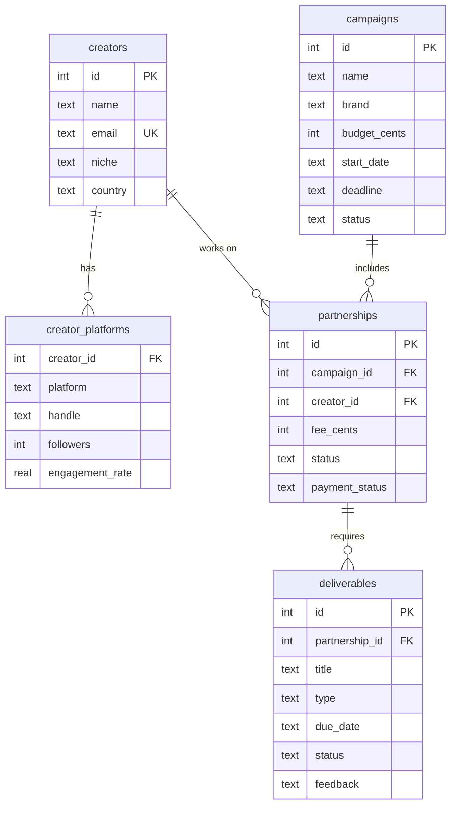

# CreatorHub

**Creator & brand partnership management platform**: a full-stack SaaS-style app for discovering creators, running marketing campaigns, tracking brand–creator partnerships and monitoring performance.

Built with **Next.js 16 (App Router), React 19, TypeScript, SQLite (better-sqlite3), Zod and Vitest**.

## Features

| Area             | What you can do                                                                                                                                                                                                                     |
| ---------------- | ----------------------------------------------------------------------------------------------------------------------------------------------------------------------------------------------------------------------------------- |
| **Creators**     | Add, edit and delete creators; store contact details plus multiple social platforms (handle, followers, engagement rate); search and filter by text, platform, niche, country, minimum followers and engagement; sort and paginate. |
| **Campaigns**    | Create campaigns with budget, start date, deadline and status (draft, active, completed, cancelled); see committed vs. paid spend and deliverable progress at a glance.                                                             |
| **Partnerships** | Assign creators to campaigns with an agreed fee; track partnership status, payment status, content deliverables and per-deliverable approval (submit, approve, request changes with feedback).                                      |
| **Analytics**    | Dashboard with total creators, active campaigns, partnership spend (committed, paid, outstanding), budget utilization, deliverable and partnership completion rates, engagement by platform, top creators and spend per campaign.   |

### Business rules enforced by the API

- Partnership fees in a campaign can never exceed its budget (cancelled partnerships free up budget); a budget can't be lowered below committed spend.
- One partnership per creator per campaign; no new partnerships on completed or cancelled campaigns.
- A partnership can only be **completed** once all its deliverables are approved, and only started (not proposed or cancelled) partnerships can be marked **paid**.
- Requesting changes on a deliverable requires feedback.
- Creators with partnerships, and paid partnerships or campaigns, can't be deleted (409 with an explanation).

## Quick start

```bash
npm install
npm run db:seed     # optional: demo data (12 creators, 4 campaigns, 10 partnerships)
npm run dev         # http://localhost:3000
```

Requires Node 20+. The SQLite database is created automatically at `data/creatorhub.db` (override with `DATABASE_PATH`, see `.env.example`).

## Scripts

| Command                                       | Purpose                                                               |
| --------------------------------------------- | --------------------------------------------------------------------- |
| `npm run dev` / `build` / `start`             | Develop, build and serve                                              |
| `npm test`                                    | Run the test suite (repositories, API routes, validation, formatting) |
| `npm run lint` / `typecheck` / `format:check` | Static checks (also run in CI)                                        |
| `npm run db:seed`                             | Seed demo data (`-- --force` wipes and reseeds)                       |

## Architecture

```
src/
  app/                 Next.js routes
    api/               REST route handlers (thin: parse, call repository, return JSON)
    creators/ campaigns/ partnerships/   Server-rendered pages
  components/          UI (server components + small client islands for forms and actions)
  lib/
    schema.ts          SQL DDL + enums (single source of truth)
    db.ts              Connection, schema creation on open, test helpers
    validation.ts      Zod schemas for bodies and query strings
    repos/             Data access + business rules (creators, campaigns, partnerships, analytics)
    api.ts, errors.ts  Uniform error handling (400 validation, 404, 409 conflict, 500)
    seed.ts            Demo data, created through the same repositories and rules
  test/                Test helpers
```

Pages read through the repositories directly on the server; the browser changes data through the REST API. Both paths use the same validated, rule-enforcing code.

### Data model



Design notes: money is stored as integer cents; constraints (`CHECK`, `UNIQUE`, foreign keys with `RESTRICT`/`CASCADE`) live in the database as a second line of defence; list queries are parameterized and escape `LIKE` wildcards; a partnership's approval status is derived from its deliverables rather than stored.

## REST API

All bodies are JSON. Errors look like `{ "error": "message", "details": [{ "path": "email", "message": "Invalid email" }] }`. Amounts are in **cents**. Lists return `{ items, total, page, limit, totalPages }`.

| Method & path                                | Description                                                                                                                                               |
| -------------------------------------------- | --------------------------------------------------------------------------------------------------------------------------------------------------------- |
| `GET /api/creators`                          | List. Query: `q`, `platform`, `niche`, `country`, `minFollowers`, `minEngagement`, `sort` (name, followers, engagement, newest), `order`, `page`, `limit` |
| `POST /api/creators`                         | Create (with `platforms: [{ platform, handle, followers, engagementRate }]`)                                                                              |
| `GET / PUT / DELETE /api/creators/:id`       | Read, replace, delete                                                                                                                                     |
| `GET /api/campaigns`                         | List. Query: `q`, `status`, `sort` (newest, deadline, budget, name), `page`, `limit`                                                                      |
| `POST /api/campaigns`                        | Create `{ name, brand, description?, budgetCents, startDate, deadline, status? }`                                                                         |
| `GET / PUT / DELETE /api/campaigns/:id`      | Read, replace, delete                                                                                                                                     |
| `PATCH /api/campaigns/:id`                   | Change status `{ "status": "active" }`                                                                                                                    |
| `GET /api/partnerships`                      | List. Query: `campaignId`, `creatorId`, `status`, `paymentStatus`, `page`, `limit`                                                                        |
| `POST /api/partnerships`                     | Create `{ campaignId, creatorId, feeCents, status?, notes?, deliverables? }`                                                                              |
| `GET / PATCH / DELETE /api/partnerships/:id` | Read, update `{ feeCents?, status?, paymentStatus?, notes? }`, delete                                                                                     |
| `POST /api/partnerships/:id/deliverables`    | Add a deliverable `{ title, type?, dueDate? }`                                                                                                            |
| `GET / PATCH / DELETE /api/deliverables/:id` | Read, update `{ status?, feedback?, ... }`, delete                                                                                                        |
| `GET /api/analytics`                         | Dashboard metrics                                                                                                                                         |
| `GET /api/health`                            | Liveness and database check                                                                                                                               |

Example:

```bash
curl -X POST localhost:3000/api/creators -H 'content-type: application/json' -d '{
  "name": "Ada Lovelace", "email": "ada@example.com", "niche": "Tech",
  "platforms": [{ "platform": "youtube", "handle": "@ada", "followers": 120000, "engagementRate": 4.2 }]
}'
```

## Testing & CI

`npm test` runs 30+ tests: repository logic against in-memory SQLite (search, filter, sort, pagination, budget and approval rules, analytics), API route handlers end to end, and validation. GitHub Actions runs the format check, lint, typecheck, tests and build on Node 20 and 22 for every push and pull request.

## Possible next steps

Authentication and multi-tenant workspaces, file uploads for deliverables, email notifications, CSV export, Postgres for production hosting (the repository layer isolates all SQL), and live social-platform stats via their APIs.

## License

[MIT](LICENSE)
